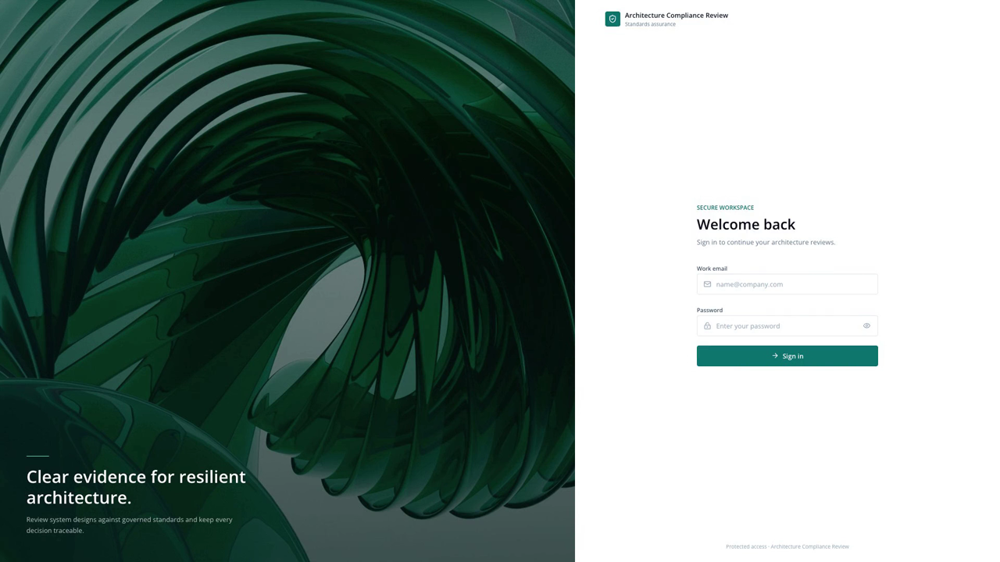

<div align="center">

# Architecture Compliance Review

**AI-assisted compliance review of design documents against your organization's engineering standards.**

[](https://python.org)
[](https://aws.amazon.com/bedrock/)
[](https://nextjs.org)
[](https://www.terraform.io)

</div>

---

## Overview

Organizations record their engineering standards in policy documents, then review
design documents against them by hand. The review is time-consuming, and results
vary between reviewers.

Architecture Compliance Review automates the review in three stages:

1. **Build a rule library.** Upload policy documents. The solution extracts each
   requirement as a structured rule, classified by service tier, architectural
   layer, and hosting scope. Extracted rules are proposals; a curator approves
   them before they take effect.
2. **Upload a design document.** PDF and PowerPoint are supported, including
   embedded diagrams.
3. **Run a validation.** Each applicable rule is evaluated against the document.
   The result is a per-rule verdict with the supporting quotation, its page
   reference, and the model's reasoning, plus an overall compliance score.

The reference implementation is configured for High Availability standards, and
the rule library, tier model, and prompts are configurable for other compliance
domains.

## Demo

[](docs/assets/architecture-compliance-review-demo.mp4)

## Features

### Rule library

| Feature | Description |
|---|---|
| Automated rule extraction | Extracts individual rules from policy documents, one unit per page or slide. Text, tables, and diagrams are each handled by a suitable model. |
| Structured classification | Each rule carries a service tier (1–5), architectural layer, and hosting scope (on-premises, cloud, or both). Validation selects rules on these fields. |
| Decision-tree rules | Supports founding rules, substitutions that satisfy a founding rule by another means, and exceptions that mark a rule non-applicable. |
| Review workflow | Extracted rules are held as proposals in a review batch. Approval, rejection, and per-rule editing are curator actions and are recorded in the audit trail. |
| Hosting-scope check | The hosting scope selected at upload is applied to every rule extracted from that document, so a wrong selection would mislabel the whole set. The scope is also inferred from the document's content, and a confident disagreement is reported on the review batch with a one-step correction for all of its rules. |
| Duplicate consolidation | Rules repeated across pages are merged, first by exact key and then by model comparison. |
| Manual authoring | Rules can be created, edited, and archived directly in the UI. |
| Curate with AI | A conversational interface proposes rule additions and edits from a document or a prompt. Responses stream as they are generated. |
| References | Factual context blocks, such as an approved data-center pairing table, are attached to matching rules at prompt-build time. |
| Custom icon legend | Registers proprietary diagram iconography so extraction and validation can interpret an organization's own notation. Model-derived definitions remain drafts until approved. |

### Validation

| Feature | Description |
|---|---|
| Parallel evaluation | The document is split into overlapping windows; each rule–window pair is evaluated concurrently. |
| Evidence for every verdict | Each finding records the quoted text, page reference, affected components, and the model's reasoning. |
| Adversarial verification | Failures at configured severities are re-examined by a second pass that attempts to refute them, which reduces false failures. |
| Diagram analysis | Architecture diagrams are evaluated visually, so topology that appears only in a drawing is assessed. |
| Compliance scoring | A severity-weighted score. Rules the document does not address are reported separately and excluded from the score rather than counted as failures. |
| Decision-tree rollup | Reports a per-layer and overall architecture verdict derived from founding, substitution, and exception outcomes. |
| Result caching | Repeat runs of the same document and rule set return the prior result. Editing any rule invalidates the cache. |
| Cancellation | An in-progress validation can be stopped; the run halts at its next checkpoint. |
| Report export | Findings are downloadable as CSV or PDF. |
| Finding-level chat | A conversational interface answers questions about an individual finding, with responses streamed. |

### Documents and search

| Feature | Description |
|---|---|
| PDF and PowerPoint ingestion | PowerPoint files are converted by an isolated sidecar service. Slides are rasterized for visual analysis. |
| In-app document viewer | Displays the source document alongside its findings, with a slide filmstrip for presentations. |
| Service tier classification | Infers a document's service tier, which the reviewer can override. |
| Processing visibility | Reports upload, parse, extraction, and Knowledge Base synchronization status per document. |
| Ask Documents | Natural-language question answering over indexed documents, using Amazon Bedrock Knowledge Bases. |

### Administration

| Feature | Description |
|---|---|
| Role-based access control | Four roles — administrator, validator, curator, and viewer — with separation of duties between running validations and editing the rule library. |
| Resource ownership | Changes to a document's service tier and cancellation of a validation are restricted to the owner or an administrator. |
| SAML federation | Cognito user pool with an optional SAML identity provider. A pre-token Lambda function maps identity-provider groups to roles. |
| Non-root containers | Both images run as unprivileged users (API `appuser`, sidecar `converter`). The API parses attacker-supplied PDF and PowerPoint files through native libraries, so it must not run as uid 0. |
| Dependency scanning | A `dependency-audit` CI job runs `pip-audit` and gates on zero unaccepted advisories. Each ignore is documented with why it cannot be fixed here (a pinned parent caps the vulnerable child, or no patched release exists). |
| Amazon Bedrock Guardrails | Every model call carries a guardrail that redacts PII and credentials. Content filters, denied topics, and prompt-attack detection are deliberately not enabled: compliance material legitimately discusses security controls, and the prompt-attack filter blocks the solution's own prompts at every strength. Prompt-injection defence for untrusted text is applied in the application instead. |
| Audit trail | Two records: an application audit table for in-product actions, queryable per document or per rule, and AWS CloudTrail for AWS API calls including model invocations. |
| Monitoring | CloudWatch alarms for ECS, load balancer, DynamoDB, API errors, Amazon Bedrock throttling, guardrail interventions, and daily estimated model spend. |
| Deploy-time tuning | Model selection, concurrency, and limits are set through environment variables. See [infrastructure/EXTRACTION_TUNING.md](infrastructure/EXTRACTION_TUNING.md). |

## Contents

| Section | |
|---|---|
| [Quick start](#quick-start) | Run it locally |
| [Deploy to AWS](#deploy-to-aws) | One script, any account |
| [Architecture](#architecture) | Solution architecture |
| [Testing](#testing) | Running the suites |
| [Repo layout](#repo-layout) | Where things live |

### Additional documentation

| Doc | Contents |
|---|---|
| [docs/architecture.md](docs/architecture.md) | Components, data flow, design decisions |
| [docs/validation-flow.md](docs/validation-flow.md) | How a validation runs, end to end |
| [docs/extraction-flow.md](docs/extraction-flow.md) | How rules are extracted from a policy document |
| [docs/RBAC.md](docs/RBAC.md) | Roles, role resolution, and resource ownership |
| [docs/deployment.md](docs/deployment.md) | Deployment guide, first-run setup, troubleshooting |
| [docs/agentcore-decision.md](docs/agentcore-decision.md) | Why the managed agent runtime was evaluated and removed, and what replaced it |
| [infrastructure/EXTRACTION_TUNING.md](infrastructure/EXTRACTION_TUNING.md) | Tuning models and limits without a code change |
| [tests/README.md](tests/README.md) | Test layout and how to run each suite |

---

## Quick start

**Prerequisites:** AWS credentials, Python 3.11+, Node 20+, and Amazon Bedrock
model access in your Region. Docker and Terraform are required only for
deployment.

```bash
# Backend → http://localhost:8000
cd backend
python -m venv .venv && source .venv/bin/activate
pip install -r requirements.txt
cp .env.example .env        # set S3_DOCUMENTS_BUCKET + DYNAMODB_TABLE_PREFIX
uvicorn app.main:app --reload --port 8000
```

```bash
# Frontend → http://localhost:3000
cd frontend
npm install
echo 'NEXT_PUBLIC_API_URL=http://localhost:8000' > .env.local
npm run dev
```

The backend prints a configuration summary at startup and reports any missing
values. Sample documents are in `data/`.

> If `npm run dev` does not complete its first compile, use `npm run dev:webpack`.

## Deploy to AWS

`infrastructure/` is a single reusable Terraform root module. A per-target
variable file supplies the project name, Region, and resource names, and
`deploy.sh` reads the same file. Deploying to another account or environment
means pointing at a different variable file rather than editing code.

```bash
# 1. Create the deployment configuration (once per target).
cp infrastructure/tfvars/dev.example.tfvars infrastructure/tfvars/dev.tfvars
#    Set project_name and environment. Real tfvars files are gitignored.

# 2. Select and confirm the target account.
export AWS_PROFILE=<profile>
aws sts get-caller-identity

# 3. Deploy. ENVIRONMENT selects tfvars/<env>.tfvars (default: dev).
ENVIRONMENT=dev ./deploy.sh all          # infra + sidecar + backend + frontend

# 4. Create a user, then open the application.
ENVIRONMENT=dev ./deploy.sh create-user you@example.com
echo "https://$(cd infrastructure && terraform output -raw cloudfront_domain_name)"
```

Individual components can be deployed separately:

```bash
ENVIRONMENT=dev ./deploy.sh infra            # Terraform apply
ENVIRONMENT=dev ./deploy.sh backend          # build → ECR → ECS rollout
ENVIRONMENT=dev ./deploy.sh frontend         # build → S3 → CloudFront invalidation
ENVIRONMENT=dev ./deploy.sh pptx-converter   # the LibreOffice sidecar
ENVIRONMENT=dev ./deploy.sh seed-users       # one user per role, for development
```

On a new account, one step requires manual action: granting
`aoss:APIAccessAll` to the deploying principal, which the Amazon Bedrock
Knowledge Base requires to create its vector index. `deploy.sh` detects this
condition and prints the required command. See
[docs/deployment.md](docs/deployment.md) for this and other first-run details.

## Architecture

<div align="center">
<a href="docs/assets/architecture.png">
  
</a>
</div>

### Observability and evaluation

Two capabilities make the agentic behaviour inspectable rather than opaque:

- **Distributed tracing (always on).** The backend container runs under
  OpenTelemetry auto-instrumentation, so FastAPI requests and every Bedrock,
  DynamoDB and S3 call are traced with no application code changes.
  `infrastructure/modules/tracing` enables CloudWatch Transaction Search, which
  indexes those spans into the `aws/spans` log group behind the Application
  Signals / GenAI observability views — so extraction, validation and query are
  traceable end to end, and a log line can be pivoted straight to its trace.
- **Golden-set evaluation gate.** `backend/evaluation/run_eval.py` drives a
  golden set through the **deployed** API and scores each answer with a Bedrock
  judge on correctness and groundedness, exiting non-zero below a threshold so it
  works as a release gate. It scores through the API rather than importing the
  agent, because that is the only path that exercises auth, the route, the tools,
  the guardrail and the data plane together.

Together with the Bedrock guardrail, Cognito RBAC, CloudWatch alarms and
CloudTrail, these are all part of the single deployed stack — there are no
feature flags to remember.

## Testing

Tests are in [`tests/`](tests/README.md), grouped by the component they cover.
`pytest` requires no environment setup; credentials and configuration are
injected by `tests/conftest.py`.

```bash
pytest                       # backend + infrastructure
cd frontend && npm test      # frontend (vitest)
```

`.gitlab-ci.yml` runs the backend, frontend, Terraform, Checkov policy, and
dependency-audit checks on every push. All five jobs are hermetic: no AWS
credentials, no deployed environment, and no model usage.

End-to-end tests run against a deployed environment and incur model usage
charges, so they are opt-in:

```bash
pytest -m e2e --run-e2e      # see tests/README.md for the required variables
```

## Repo layout

```
backend/            FastAPI service
  app/
    api/routes/     One module per resource (documents, validations, standards, …)
    agents/         Bedrock agents: extraction pipeline and the Q&A query agent
    services/       Stores (DynamoDB/S3), validators, converters, the curator
    models/         Pydantic request/response and persisted shapes
    bedrock_models.py   Model IDs — the single place a version is declared
  evaluation/       Golden-set evaluation gate: drives the deployed API and
                    scores answers with a Bedrock judge (CI release gate)
  lambdas/          Cognito pre-token hook (maps IdP groups to roles)
  services/         The PPTX-to-PDF sidecar container

frontend/           Next.js 16 static export
  src/app/          Pages (documents, standards, validation, query, admin)
  src/components/   UI components, grouped by feature
  src/lib/api.ts    Typed API client

infrastructure/     Terraform root module and modules (vpc, ecs, s3, dynamodb,
                    cloudfront, cognito, bedrock, bedrock-guardrail,
                    knowledge-base, lambda-pretoken, cloudtrail, monitoring,
                    tracing)
  tfvars/           One variable file per deployment target

tests/              backend · infra · frontend · e2e
docs/               Architecture, flow, and RBAC documentation
data/               Sample standards documents, mock design documents, and an
                    icon-legend test set (glyph crops and on-premises diagrams)
deploy.sh           Deployment entry point
```

## Tech stack

| Layer | |
|---|---|
| Frontend | Next.js 16, React 19, Tailwind CSS, shadcn/ui |
| Backend | FastAPI, Python 3.11, Strands Agents SDK |
| AI | Amazon Bedrock (Claude Sonnet and Opus), Amazon Bedrock Knowledge Bases, Amazon Bedrock Guardrails |
| Data | Amazon DynamoDB, Amazon S3, Amazon OpenSearch Serverless |
| Infrastructure | Terraform, Amazon ECS on AWS Fargate, Application Load Balancer, Amazon CloudFront, Amazon Cognito, AWS Lambda |
| Observability | OpenTelemetry (ADOT), AWS X-Ray, CloudWatch Transaction Search, CloudWatch alarms, AWS CloudTrail |
| Documents | PyMuPDF, LibreOffice (sidecar) |

## Contributors

- [Vivian Bui](https://www.linkedin.com/in/vivian-bui-413a561b6/)
- [Gonzalo Escarra](https://www.linkedin.com/in/gescarra/)
- [Glen Knight](https://www.linkedin.com/in/glen-knight-2a5b712b/)

## Security

See [CONTRIBUTING](CONTRIBUTING.md#security-issue-notifications) for more
information.

This is sample code for demonstration purposes. Review it against your own
security, compliance, and operational requirements before using it with
production data. In particular, set a custom domain with ACM certificates
before handling real documents; see
[TLS and a custom domain](docs/deployment.md#tls-and-a-custom-domain).

## License

This library is licensed under the MIT-0 License. See the [LICENSE](LICENSE)
file.
