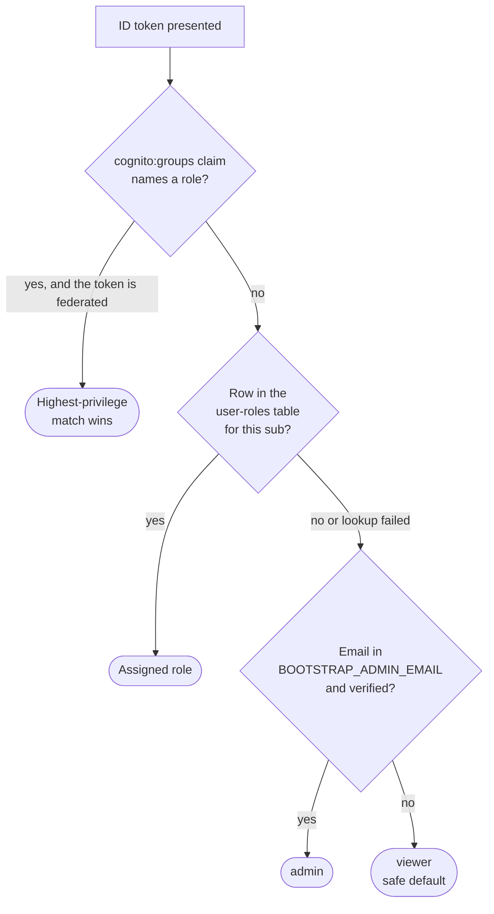
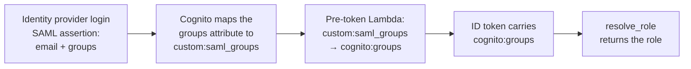

# Role-based access control

The solution defines four roles with separation of duties. This document
describes how a caller's role is resolved, how per-row ownership is enforced, and
the steps required to drive roles from an external identity provider such as
Microsoft Entra ID through Amazon Cognito groups.

## Roles

| Role | Permitted | Not permitted |
|---|---|---|
| `admin` | All actions, including user role management (`/admin/roles`, `/api/roles`) | — |
| `validator` | Upload design documents, run validations, view results, view the rule library, query documents | Write to the standards library |
| `curator` | Upload standards documents, edit the library, approve and reject proposed rules, use Curate with AI, query documents | Run validations |
| `viewer` | Read-only access and document queries | Any write operation |

Enforcement is server-side. Every router carries `Depends(get_current_user)`
(`backend/app/main.py`), and write endpoints add `Depends(require_role(...))`
(`backend/app/api/rbac.py`), which resolves the caller's role and returns HTTP 403
if it is not permitted. The frontend `useRole()` hook
(`frontend/src/lib/use-role.tsx`) mirrors the matrix to hide actions the caller
cannot perform. The frontend behavior is defense in depth and a user-experience
measure; the backend dependency is the control.

**The administrator role is implicit.** `require_role(...)` always adds `admin` to
the allowed set, so a call site lists only the non-administrator roles that also
qualify. `require_role()` with no arguments therefore means administrator-only,
which is how the `/api/roles` endpoints are gated. The resolved role is stored on
the claims dictionary as `_role` so that a handler can read it. The document
upload endpoint uses that, because one endpoint serves two document types with
different permissions: a design document upload requires `validator`, and a
standards upload requires `curator`.

Where `require_role` is applied: `/api/validations` create, cancel, and finding
chat require `validator`; `/api/standards` writes, curation, and the curator chat
stream require `curator`; every `/api/icon-legend` write requires `curator`;
`/api/roles` management requires `admin`; and `/api/health/detail` requires
`admin`. Read endpoints and `/api/queries` are open to any authenticated caller,
which is what makes `viewer` read-and-query. Curator and administrator actions are
also recorded to the audit-events table, readable through `/api/audit`.

Two similarly named endpoints belong to different features by design.
`POST /api/standards/curate` selects the most relevant existing rules for one
document, which is read-only rule selection reached from the Run Validation
dialog, and allows `validator` or `curator`. `POST /api/standards/chat` is the AI
rule curator that proposes library changes, and is restricted to `curator`.

## Resource ownership, per-row authorization

A role gate answers whether a user may ever perform an action. It cannot answer
whether the user may perform it against a specific row, and two mutations require
that second question:

| Endpoint | Role gate | Ownership field |
|---|---|---|
| `PATCH /api/documents/{id}/tier` | `validator` | `uploaded_by` |
| `POST /api/validations/{id}/cancel` | `validator` | `triggered_by` |

`require_owner_or_admin()` in `backend/app/api/rbac.py` enforces this. The
service tier determines which rules a document is judged against, so changing
another user's document changes their verdict. A cancellation stops a run that
consumes Amazon Bedrock capacity until it halts. Administrators always pass. Rows
with no recorded owner, which predate the field, remain mutable by any role
holder; refusing them would leave existing documents with no one able to correct
them.

Ownership is write-once. `validation_store.save_validation` re-attaches the
existing `triggered_by` when the incoming object does not carry one, because the
background validator rewrites the row several times from newly constructed
`ValidationResult` objects. Threading the owner through each construction site
would lose it as soon as another site was added.

**Reads are shared by design.** The four roles form a shared review model: a
curator reviews design documents a validator uploaded, and `viewer` exists to
read results. Per-user read isolation would break separation of duties and make
the audit trail unusable as evidence. This is ownership on writes rather than
multi-tenancy. There is no `tenant_id` or `team_id` field, and adding one is
warranted only if separate business units or customers share a deployment.

One exception applies on the read side. `GET /api/audit?actor_sub=<sub>` returns
everything one user has done, which is a profile of a colleague's activity rather
than review evidence, so it is restricted to the caller or an administrator.
Per-entity history (`?entity_type=…&entity_id=…`) remains open to any
authenticated caller, because that is the review trail for a shared document.

## How a role is resolved

`resolve_role(claims)` in `backend/app/api/rbac.py` tries sources in priority
order and fails closed, defaulting to `viewer`, so that a resolution failure
never grants access:



1. **`cognito:groups` claim on the token.** If the ID token carries a
   `cognito:groups` claim naming one of the four roles, the highest-privilege
   match wins. The claim is honored only when the token carries a federated
   identity. On a native user name and password login, the underlying attribute
   is not identity-provider-controlled, so trusting the claim there would let a
   user who can write their own attributes select their own role.
2. **Per-user assignment in the `user-roles` DynamoDB table**, keyed on the
   Cognito `sub`. Written by an administrator through `PUT /api/roles`
   (`backend/app/api/routes/roles.py`) and the `/admin/roles` interface. This is
   the fallback for any user with no role-naming group claim, and a store lookup
   failure is caught and falls through rather than granting access.
3. **`BOOTSTRAP_ADMIN_EMAIL`**, a comma-separated list of email addresses that
   resolve to `admin`, which seeds the first administrator before any role rows
   exist. A match requires a verified email address, because the address is
   otherwise self-asserted. Set from `var.bootstrap_admin_email` in your
   Terraform variable file.
4. **`viewer`**, the safe default: an unknown authenticated user can read but
   cannot change anything.

## Identity state: SAML federation with a test identity provider

The Cognito module (`infrastructure/modules/cognito/main.tf`) provisions:

- **Four `aws_cognito_user_group` resources** — `admin`, `curator`, `validator`,
  and `viewer`, with names matching the `Role` enumeration values. Membership
  appears in `cognito:groups` and is exercised by the `test_group_claim_*` cases
  in `tests/backend/test_rbac.py`.
- **A SAML identity provider** (`aws_cognito_identity_provider.saml`, gated by
  `var.enable_saml_idp`). In the development configuration it federates the
  public mocksaml.com test identity provider. The web app client lists both
  `COGNITO` for user name and password and the SAML provider, so both login paths
  are available.
- **A pre-token-generation Lambda function** (`modules/lambda-pretoken`, handler
  `backend/lambdas/pretoken/handler.py`) on the pool's `pre_token_generation`
  trigger. It reads the custom attribute `custom:saml_groups`, populated from the
  SAML assertion through the provider's `attribute_mapping`, maps each group to a
  role, and emits `cognito:groups`, which is the claim `resolve_role` reads. The
  function uses only the standard library, accepts comma- or
  semicolon-separated group lists because identity providers differ, emits roles
  in a stable privilege-descending order, and applies no override when the
  attribute is absent, malformed, or contains only unknown values, so resolution
  falls through to the table, bootstrap, or viewer.
- **A `custom:saml_groups` pool attribute** and the SAML-to-attribute mapping.

The SAML-to-role chain:



**Test identity provider limitation.** mocksaml.com does not emit a groups
attribute, so a federated mocksaml login carries no role group and resolves to
`viewer`, the safe default. This confirms the federation path end to end:
redirect, SAML, Lambda, token, session. Per-role coverage comes from
`tests/backend/test_pretoken_lambda.py`, `tests/backend/test_rbac.py`, and the
four seeded user name and password users created by `deploy.sh seed-users`, which
log in as each role and are placed in the matching Cognito group. Driving all
four roles through SAML in a browser requires an identity provider that emits
per-user groups, which is what Entra ID provides.

## Migrating to Microsoft Entra ID

The configuration above is identity-provider-agnostic, and switching from
mocksaml to Entra ID requires no backend API change. Steps 1 and 2 are Terraform
variable changes only. Step 3 edits the Lambda handler, whose archive is
content-addressed (`infrastructure/modules/lambda-pretoken/main.tf`), so
`terraform apply` detects the edit and redeploys only the function.

1. **Point the identity provider at Entra ID** in your Terraform variable file:

   ```hcl
   saml_provider_name = "EntraID"
   saml_metadata_url  = "<Entra enterprise application → SSO → App Federation Metadata Url>"
   ```

   `saml_metadata_url` sets `provider_details.MetadataURL` on
   `aws_cognito_identity_provider.saml`. `saml_provider_name` is also the
   provider name the frontend passes to `signInWithRedirect`, published through
   the `cognito/saml-provider` SSM parameter.

2. **Point the groups attribute at the Entra ID group claim.** Set
   `var.saml_groups_attribute` in the Cognito module to the SAML attribute name
   Entra ID emits for its group claim, configured under Enterprise application →
   Single sign-on → Attributes and Claims → Add a group claim. The default is
   `groups`.

3. **Map Entra ID groups to roles in the Lambda function.** Entra ID typically
   sends group object IDs rather than names. Edit `GROUP_MAP` in
   `backend/lambdas/pretoken/handler.py` so that each role points at its Entra ID
   group object ID. The handler inverts the map into a value-to-role lookup, so
   the object ID becomes what an assertion is matched against. It already
   lower-cases values, removes duplicates, and drops unknown entries.

4. **Assign users and groups to the application** in Entra ID, then sign in with
   SSO. Verify with `GET /api/roles/me`; the resolved role should match the
   user's Entra ID group.

> **Token size:** `custom:saml_groups` is limited to 2048 characters. A user in
> many Entra ID groups can exceed it. Scope the Entra ID group claim to "Groups
> assigned to the application" in the application registration to mitigate this.

> `resolve_role` performs its own highest-privilege selection among named groups,
> so Cognito group `precedence` is not relied on for correctness.

## Seeding per-role users

For Cognito-native deployments, `deploy.sh seed-users` creates one Cognito user
per role, sets a permanent password so there is no force-change challenge, adds
the user to the matching Cognito group, and writes the matching row to the
`user-roles` table. The group placement is what makes the `cognito:groups` claim
resolve the role through branch 1; the table row is a redundant fallback. The
command is idempotent: an existing user is tolerated, and its password, role row,
and group membership are re-applied.

**Passwords are not defaulted.** `RBAC_<ROLE>_PASSWORD` has no fallback value.
When it is unset, `seed-users` generates a random password that satisfies the
Cognito policy and prints it once at the end of the run, so the credential exists
only in that terminal output. A fixed default would mean that a seed run against
any long-lived environment created four logins whose passwords are published in
this repository. Only generated passwords are echoed; a password supplied through
an environment variable is already known to the operator and is not written to the
logs.

`./deploy.sh create-user <email> [password]` behaves the same way: omit the
password and one is generated and printed once.

Email defaults do exist — `RBAC_ADMIN_EMAIL`, `RBAC_VALIDATOR_EMAIL`,
`RBAC_CURATOR_EMAIL`, and `RBAC_VIEWER_EMAIL`, falling back to
`<role>@example.com`. These are for development and demonstration only; set them
explicitly for any shared environment. See the header comment in `deploy.sh` and
`seed_users()`.

> Run `./deploy.sh infra` at least once so that the Cognito groups exist before
> running `seed-users`. If they are missing, `seed-users` still succeeds: it warns,
> and the role resolves through the table row instead.

These four logins are also what the end-to-end suite authenticates with. See
[tests/README.md](../tests/README.md) for the `E2E_*` variables it reads.
