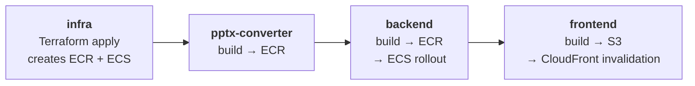

# Deployment guide

This guide covers deploying Architecture Compliance Review to an AWS account using the
included `deploy.sh` script and Terraform.

## Solution architecture

<div align="center">
<a href="./assets/architecture.png">
  
</a>
</div>

## Prerequisites

| Requirement | Minimum version |
|---|---|
| AWS CLI | v2 |
| Terraform | 1.10.0 |
| Docker Desktop | Running |
| Node.js | 20 |
| Python | 3.11 |

The AWS provider is pinned to `~> 6.0` (`infrastructure/providers.tf`).

## AWS services used

| Service | Purpose | Pricing model |
|---|---|---|
| Amazon ECS on AWS Fargate | Application compute: the API service and the pptx-converter service | Per vCPU-hour and GB-hour |
| Application Load Balancer | API routing and health checks | Per hour and LCU |
| Amazon CloudFront | Content delivery for the frontend and API | Per request and data transfer |
| Amazon S3 | Document storage and frontend hosting | Per GB stored and requests |
| Amazon DynamoDB | Eight on-demand tables | Per request |
| Amazon Bedrock | Model inference and Amazon Titan embeddings | Per input and output token |
| Amazon OpenSearch Serverless | Vector index behind the Knowledge Base | Per OCU-hour |
| Amazon Cognito | Authentication | Per monthly active user |
| AWS Lambda | Pre-token-generation trigger, mapping SAML groups to roles | Per request |
| AWS Cloud Map | Internal DNS for the pptx-converter service | Per namespace and query |
| Amazon ECR | Two container image repositories | Per GB stored |
| Amazon CloudWatch | Log groups, alarms, dashboard, metric filter | Per metric and log GB |
| AWS Systems Manager Parameter Store | Cognito configuration read at frontend build time | Free tier for standard parameters |
| NAT gateway | Outbound internet access for ECS tasks | Per hour and GB processed |
| Amazon SNS | Alarm notifications | Per notification |
| AWS X-Ray | Trace ingestion for the OpenTelemetry spans the backend emits | Per trace recorded/retrieved |
| CloudWatch Transaction Search | Indexes spans into `aws/spans` for Application Signals / GenAI views | Per ingested span |

## Quick deploy

```bash
# 1. Configure the target.
cp infrastructure/tfvars/dev.example.tfvars infrastructure/tfvars/dev.tfvars
# Set project_name (21 characters or fewer) and environment.

# 2. Set AWS credentials.
cp .env.example .env
# Add the AWS access key, secret access key, and Region.
source .env

# 3. Verify the credentials resolve to the intended account.
aws sts get-caller-identity

# 4. Deploy.
ENVIRONMENT=dev ./deploy.sh all

# 5. Create a user. The password is optional; one is generated and printed if omitted.
ENVIRONMENT=dev ./deploy.sh create-user you@example.com

# 6. Retrieve the application URL.
cd infrastructure && terraform output -raw cloudfront_domain_name
```

`deploy.sh all` runs its stages in a required order:



The infrastructure apply creates the Amazon ECR repositories and the ECS
services, neither of which validates an image at creation time. The images are
pushed next. The converter precedes the backend so that the API's
`PPTX_CONVERTER_URL` points at a service already accepting requests. The frontend
is last because its build reads Cognito values from Parameter Store that exist
only after the apply.

## Deploy individual components

```bash
ENVIRONMENT=dev ./deploy.sh infra            # Terraform init, plan, apply
ENVIRONMENT=dev ./deploy.sh backend          # Build, push to ECR, redeploy ECS
ENVIRONMENT=dev ./deploy.sh pptx-converter   # Converter image (alias: sidecar)
ENVIRONMENT=dev ./deploy.sh frontend         # Build, sync to S3, invalidate CloudFront
ENVIRONMENT=dev ./deploy.sh create-user <email> [password]
ENVIRONMENT=dev ./deploy.sh seed-users       # One login per role
```

`create-user` and `seed-users` require only AWS credentials and Terraform output.
They are handled before the heavier prerequisite checks, so they work when Docker
is not running. Both are idempotent: an existing user is tolerated, and its
password and, for `seed-users`, its role row and group membership are re-applied.
See [RBAC.md](./RBAC.md#seeding-per-role-users) for password handling.

Environment overrides accepted by the script: `ENVIRONMENT`, `TFVARS_FILE`,
`PROJECT`, `AWS_REGION`, `AWS_ACCOUNT_ID`, `TF_STATE_BUCKET`, and
`TF_STATE_KEY`.

## Configuration

### Required variables

Neither variable has a default, so a new project must name itself explicitly
rather than inheriting another project's resource names.

```hcl
project_name = "my-compliance-tool"   # lowercase, 21 characters or fewer
environment  = "dev"                  # lowercase, 11 characters or fewer
```

The 21-character limit is enforced by a variable validation. `project_name`
prefixes every resource, and `<project>-<env>-kb-data` must remain within the
Amazon OpenSearch Serverless 32-character name limit.

### Optional overrides

```hcl
aws_region         = "us-east-1"        # default
task_cpu           = 2048               # API task, 2 vCPU (default)
task_memory        = 4096               # API task, 4 GB (default)
pptx_task_cpu      = 1024               # converter task, 1 vCPU (default)
pptx_task_memory   = 2048               # converter task, 2 GB (default)
desired_count      = 1                  # API task count
min_capacity       = 1                  # auto scaling minimum
max_capacity       = 4                  # auto scaling maximum
log_retention_days = 365                # default, one year
bedrock_model_id   = "us.anthropic.claude-sonnet-4-6"
```

LibreOffice conversion is CPU-bound and has a different resource profile from the
API, so the converter is sized separately through `pptx_task_cpu` and
`pptx_task_memory`.

`pptx_container_env` sets the converter's own environment:

```hcl
pptx_container_env = {
  SOFFICE_TIMEOUT_S       = "60"   # per-conversion LibreOffice timeout
  CONVERTER_TMP_ROOT      = "/tmp"
  ALLOWED_URL_HOST_SUFFIX = ".amazonaws.com"   # presigned-URL host allowlist, an SSRF guard
}
```

Keep `SOFFICE_TIMEOUT_S` below the caller's 90-second timeout
(`SIDECAR_TIMEOUT_S` in `backend/app/services/pptx_converter.py`). Otherwise the
API stops waiting before the converter finishes and the converter's error detail
is lost.

`extra_container_env` sets any of the backend's extraction and validation tuning
variables, including models, chunk sizes, concurrency, thinking flags, the
verification pass, and the icon legend cap. It is empty by default. The
recognized keys are listed in `infrastructure/variables.tf`, and the rationale
for deploy-time rather than runtime tuning is in
[infrastructure/EXTRACTION_TUNING.md](../infrastructure/EXTRACTION_TUNING.md).

### Tracing

Distributed tracing is always on; only the indexing rate is configurable, because
CloudWatch Transaction Search bills per indexed span:

```hcl
trace_sampling_percentage = 100   # default; lower it for a busy account
```

Transaction Search is an **account- and region-wide** setting. Destroying the
stack does not turn it back off — that is deliberate, so a teardown cannot blind
another workload in the same account. To disable it explicitly:

```bash
aws xray update-trace-segment-destination --destination XRay --region <region>
```

### Evaluation gate

Score the deployed stack against the golden set (needs a login and the Cognito
web client id, both from the deploy outputs):

```bash
python backend/evaluation/run_eval.py \
  --base-url "https://$(cd infrastructure && terraform output -raw cloudfront_domain_name)" \
  --user-pool-client-id "$(cd infrastructure && terraform output -raw cognito_web_app_client_id)" \
  --username you@example.com --password '<password>' \
  --threshold 0.6
```

Exit codes: `0` passed, `1` below threshold or an item errored, `2` setup problem.
It incurs model usage for each golden item plus one judge call, so it is opt-in
rather than part of `deploy.sh`.

### Load balancer origin verification

The load balancer is internet-facing, so its listener requires the
`X-Origin-Verify` header that CloudFront adds to every origin request. This is on
by default (`verify_origin_header = true`). The listener's default action returns
HTTP 403, and only the rule matching that header forwards to the target group.
Without it, the API is reachable at the load balancer's DNS name, bypassing
CloudFront.

Two consequences:

- Requests sent directly to the load balancer's DNS name return HTTP 403. Use the
  CloudFront domain, including for end-to-end tests.
- The security group also admits only CloudFront's managed origin-facing prefix
  list (`restrict_alb_to_cloudfront = true`, the default), on the one port
  CloudFront connects on: 443 when the load balancer has a certificate, 80
  otherwise. The list counts approximately 55 entries against the 60-rule
  security group quota, which a single port fits. Set it to `false` only to
  reach the load balancer directly while debugging.

### TLS and a custom domain

Without a custom domain, two connections use weaker TLS than a production
deployment should:

| Connection | Default | Set this to fix it |
|---|---|---|
| Viewer → CloudFront | The `*.cloudfront.net` certificate. AWS pins its security policy to `TLSv1` and ignores any configured minimum. | `cloudfront_acm_certificate_arn`, an ACM certificate in `us-east-1`. The minimum becomes `TLSv1.2_2021`. |
| CloudFront → load balancer | HTTP, inside the AWS network. | `certificate_arn`, an ACM certificate for the load balancer. The origin becomes HTTPS-only with the `ELBSecurityPolicy-TLS13-1-2-2021-06` policy, and port 80 redirects. |

Static scanners flag both settings in the Terraform source regardless of the
variables, because the default-certificate path has to remain expressible. Treat
those two findings as accepted for an environment without a domain, and set both
certificates before handling production data.

### Encryption keys

`modules/kms` creates one customer-managed key, with annual rotation, for the
DynamoDB tables, both ECR repositories, the alarms SNS topic and the Cognito
client-secret parameter. Disabling the key cuts off access to all of them at
once. Logs and the public frontend bucket use AWS-managed keys.

On a stack deployed before the key existed, moving the ECR repositories onto it
replaces them, which deletes their images. Run `./deploy.sh all`, which pushes
fresh images straight after the infrastructure apply, rather than a bare
`terraform apply`. The tables, topic and parameter are re-encrypted in place.

### CORS

`cors_origins` defaults to `"*"`, which is permissive. Set it to the frontend's
CloudFront URL in any shared environment. It cannot default to the CloudFront
domain in Terraform, because CloudFront already depends on the load balancer, so
wiring the domain back into ECS would create a dependency cycle. On a new account
this requires two steps: apply once with the default, then set `cors_origins` to
the printed `cloudfront_domain_name` and apply again.

The backend also guards this at runtime. A wildcard origin combined with
credentials is an invalid CORS configuration that browsers reject, so when origins
are `*` the API disables `allow_credentials` (`backend/app/main.py`).
Authentication uses a bearer header rather than cookies, so no functionality is
affected.

### Remote state

The backend block is intentionally partial (`infrastructure/backend.tf`), with
only `encrypt = true` set, so that the same root module can target any account,
bucket, and key. `deploy.sh` supplies the rest at initialization and creates the
bucket if it does not exist:

```
bucket = <project>-<env>-tfstate-<account_id>
key    = <env>/terraform.tfstate
```

The same account with a different environment produces a different key, and a
different account produces a different bucket, so states remain isolated.

## New account setup

`deploy.sh` handles most setup. One manual step is required for locked-down IAM
users, and is not needed when the deploying principal is a role:

```bash
aws iam put-user-policy \
  --user-name <DEPLOY_USER> \
  --policy-name aoss-data-access \
  --policy-document '{"Version":"2012-10-17","Statement":[{"Effect":"Allow","Action":"aoss:APIAccessAll","Resource":"*"}]}'
```

Amazon Bedrock Knowledge Bases require the vector index to exist before
`CreateKnowledgeBase` runs, so Terraform bootstraps it with a `null_resource`
that calls the Amazon OpenSearch Serverless data-plane API as the deploying
principal. That call requires `aoss:APIAccessAll`. Without it, `terraform apply`
stops responding at `null_resource.kb_index_bootstrap` rather than failing
immediately. `deploy.sh` runs a preflight check that detects the missing
permission and prints the required command. A principal lacking
`aoss:APIAccessAll` usually also lacks `iam:PutUserPolicy`, so an administrator
generally has to run the grant.

Skip the preflight check with `AOSS_PREFLIGHT_SKIP=1` once the grant is in place.

## Reusing the solution for another project

1. Copy `dev.example.tfvars` to a new file.
2. Set `project_name` and `environment`.
3. Deploy with `ENVIRONMENT=<env> ./deploy.sh all`.

All resource names, tags, and identifiers derive from those two variables. The
account ID is read from the caller identity, and the container image URI is
composed from it, so no code changes are required. Per-target Terraform variable
files, meaning anything that is not `*.example.tfvars`, are excluded from version
control, so account-specific values are not committed.

## Teardown

The load balancer has deletion protection on, so turn it off first:

```bash
cd infrastructure
terraform apply -var-file=tfvars/dev.tfvars -var alb_deletion_protection=false
terraform destroy -var-file=tfvars/dev.tfvars -var alb_deletion_protection=false
```

The customer-managed KMS key is scheduled for deletion with a 30-day waiting
period rather than deleted immediately.

This removes the AWS resources. The Amazon S3 state bucket must be emptied and
deleted manually, which is a deliberate safeguard because it holds the state
file.

## Troubleshooting

| Symptom | Cause | Resolution |
|---|---|---|
| `terraform apply` stops responding at `null_resource.kb_index_bootstrap` | The deploying principal lacks `aoss:APIAccessAll` | Grant the IAM permission, described above |
| ECS task restarts repeatedly | Missing environment variables or an invalid image | Check the CloudWatch logs at `/ecs/<project>-<env>` |
| Backend exits at startup with a configuration error | `S3_DOCUMENTS_BUCKET` or `DYNAMODB_TABLE_PREFIX` is unset | Configuration validation fails fast by design (`backend/app/config.py`); check the task definition's environment |
| HTTP 403 from the load balancer's DNS name | Origin verification is enabled, which is the default | Use the CloudFront domain; see [Load balancer origin verification](#load-balancer-origin-verification) |
| HTTP 504 on a large PowerPoint upload | CloudFront `origin_read_timeout` is capped at 60 seconds on default-tier accounts | Request a Service Quotas increase, or split the file |
| PowerPoint conversion fails or times out | The converter is unreachable, or `SOFFICE_TIMEOUT_S` is at or above the caller's 90-second timeout | Check the `/ecs/<project>-<env>-pptx-converter` logs and lower `SOFFICE_TIMEOUT_S` |
| Slides are extracted as text only | Slide PNG images are absent and there is no converted PDF to rasterize from | Check the converter service and the upload task logs |
| Frontend shows a blank page | The CloudFront cache is stale | Run `./deploy.sh frontend`, which includes an invalidation |
| The SSO sign-in button is missing | The `saml-provider` Parameter Store value is empty | Set `enable_saml_idp` and `saml_provider_name`, apply, then redeploy the frontend, because the value is read at build time |
| Knowledge Base queries return no results | The data source has not synchronized | Upload a document; the solution triggers the synchronization |
| Amazon Bedrock returns `ValidationException` on a model call | A model override whose extended-thinking request shape does not match the family | Opus takes adaptive thinking with no budget and Sonnet requires an explicit budget; see `backend/app/bedrock_models.py` |
| Reported validation cost is incorrect | `VALIDATION_MODEL_ID` was repointed without updating the price-per-million-token variables | Set `VALIDATION_INPUT_USD_PER_MTOK` and `VALIDATION_OUTPUT_USD_PER_MTOK` to match |

## Tests

All tests are in the repo-root `tests/` tree and run with `pytest` from the repo
root. The root `pytest.ini` places `backend/` on the Python path, so
`from app.main import app` resolves without path manipulation. Backend and
infrastructure tests require no AWS setup or credentials. End-to-end tests are
deselected by default and opt in with `pytest -m e2e --run-e2e`.

`.gitlab-ci.yml` runs the backend, frontend, Terraform, Checkov policy, and
`pip-audit` dependency checks on every push. The dependency job gates on zero
unaccepted advisories; each ignore is documented inline with the reason it cannot
be remediated in this tree. See [tests/README.md](../tests/README.md).
