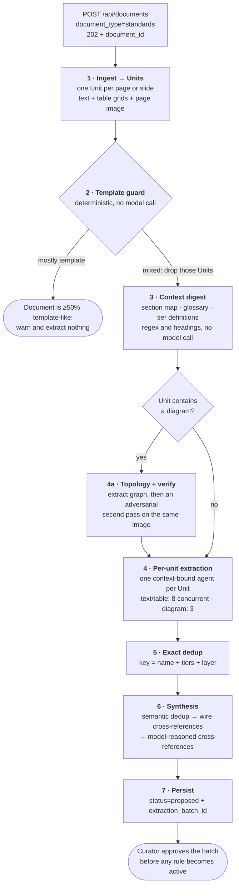

# Extraction flow

Standards extraction converts a policy document into structured rules. It is
agentic — one Strands agent per page or slide determines what constitutes a
requirement — whereas validation is deterministic.

One orchestrator handles both PDF and PowerPoint. There is no format-divergent
path: `backend/app/agents/extraction/run.py` ingests either format into a common
`Unit` type, extracts across units in parallel, then consolidates.

Extracted rules are created as proposals rather than active rules. Validation
reads active rules only, so no extracted rule can affect a compliance verdict
until a curator approves the batch.

## Pipeline



Stage detail:

| Stage | Behavior |
|---|---|
| 1 · Ingest | PDF: one Unit per parsed section, page-anchored, with per-page tables from `find_tables().extract()` as a grid, and every page rendered to PNG at 150 DPI and uploaded. PowerPoint: one Unit per slide, with native text and structured tables from `parse_pptx_native`, and slide PNGs at 144 DPI, rasterized locally from the converted PDF when the upload task has not yet produced them. Each Unit carries text, table grids, and a full-page image reference, so all downstream stages are format-agnostic. |
| 2 · Template guard | Scores each Unit from instruction phrases such as "fill out the table for each" and from blank-form tables, where at least half of the non-header cells are empty or placeholders. A document that is at least half template-like produces a warning and no rules. In a mixed document, only the instruction and placeholder Units are dropped. Disable with `ENABLE_TEMPLATE_GUARD=0`. |
| 3 · Context digest | Regular expressions and heading heuristics over the ingested text, with no model call. Produces a section map, a glossary, and tier definitions, which are passed to the cross-reference reasoning step in stage 6. |
| 4 · Per-unit extraction | One fresh, context-bound agent per Unit, run under `asyncio.to_thread` and gathered. Two semaphores apply: `EXTRACTION_MAX_CONCURRENT` (default 8) for text and table Units, and `EXTRACTION_DIAGRAM_MAX_CONCURRENT` (default 3) for diagram Units. Each agent receives, in one multimodal message, the Unit's native text as authoritative for rule wording, its tables as markdown grids, the full-page image, the preceding title Unit as orientation when one exists, and the active icon legend for diagram Units. Tools are `save_standard` and `save_reference`, both bound to the run's context. A failure is isolated to its Unit. |
| 4a · Topology and verify | For diagram Units, on the vision tier and before rule extraction: `extract_topology` produces nodes, edges, HA attributes, and notes; `verify_topology` runs a second adversarial pass, shown the same image and the claimed graph, and asked to identify every node or edge that is incorrect, missing, or fabricated, returning high, medium, or low confidence with discrepancies. The reconciled graph is injected into the extraction prompt, so rules are grounded in a verified reading. Confidence below high sets `needs_review` on every rule the Unit produces. The stage is non-fatal: a failure degrades to plain multimodal extraction. |
| 5 · Exact dedup | Key is `(name.lower().strip(), sorted(applies_to_tiers), layer)`. The first occurrence is retained and duplicates are deleted from the store. |
| 6 · Synthesis | `semantic_dedupe` buckets rules by tiers and layer, and only buckets with more than one candidate are sent to the model, which clusters restatements of the same requirement and keeps the fullest wording. Coverage is validated, and any doubt leaves the bucket unchanged, so rules are not lost. `wire_cross_references` is deterministic: an orphaned substitution or exception rule adopts the founding rule in its own tier and layer cell. `reason_cross_references` has the model read the full rule set and digest to correct parent links that span pages, and to flag contradictions and gaps. Gated by `ENABLE_EXTRACTION_SYNTHESIS` and `ENABLE_XREF_REASONING`, both on by default, and non-fatal: a failure leaves the exact-deduped set intact. |
| 7 · Persist | Every rule carries the run's `extraction_batch_id`. The document detail review panel groups by that ID, and a curator approves the batch before any rule becomes active and therefore visible to validation. |

## The Unit abstraction

A `Unit` (`backend/app/agents/extraction/unit.py`) is one PDF page or one
PowerPoint slide, and it is what allows a single pipeline to serve both formats.
Three design choices:

- **Text, tables, and image travel together** in one multimodal turn, rather
  than requiring a separate vision tool call.
- **Tables remain structured.** A `UnitTable` holds the grid as rows of cells and
  renders to a GitHub-flavored markdown table. A tab-joined string destroys the
  column structure that makes a tier-by-layer matrix readable. Ragged rows
  continue to indicate merged cells or multi-row headers.
- **Image bytes are lazy.** The Unit holds an Amazon S3 key (`image_ref`)
  resolved at call time, so a 48-page document does not hold 48 PNG images in
  memory simultaneously. A missing image degrades that Unit to text-only rather
  than failing it.

`is_diagram` is a heuristic: four or more diagram shapes, or any picture. It
determines which semaphore a Unit uses, whether topology analysis runs, and
whether the icon legend is attached.

## Why parallel extraction requires a context object

The extraction tools previously read the active document from module-level
globals, which caused two concurrent agents to overwrite each other.
`ExtractionContext` (`backend/app/agents/extraction/context.py`) replaces that:
each agent receives tools bound to a per-run context object through a factory,
with a lock around the rule sink. With no shared mutable global, agents run
concurrently and each attributes rules to its own Unit.

The context also carries the run's `batch_id` and per-Unit topology metadata, so
the bound `save_standard` can tag rules without additional plumbing.

## What save_standard enforces

The tool does not persist the model's output unmodified
(`backend/app/agents/extraction/context.py`):

- **`hosting_scope` is taken from the document** and any value the model supplied
  is ignored. Scope is a document-level declaration the user makes at upload
  time, not a per-rule judgment. Allowing the model to infer it per rule caused
  an on-premises rulebook to produce mostly `both` rules, which would then apply
  to cloud validations.
- **`layer` is normalized** to `datacenter`, `data`, `web`, `application`,
  `load_balancer`, or `general`, defaulting to `general`. `rule_type` is
  normalized to `founding`, `substitution`, or `exception`.
- **`applies_to_tiers`** is coerced to sorted unique integers from 1 to 5,
  defaulting to all five when absent or malformed.
- **`source_quote` is clipped to 500 characters**, and its absence sets
  `needs_review`. A rule with no verbatim quote was inferred by the model, often
  from a diagram, which is where a misreading is most likely.
- **`status="proposed"`** and the batch ID are always applied.

## Rules compared with references

Not every statement in a standards document is testable. Data-center and
disaster-recovery peer maps, network-zone catalogs, approved-technology lists,
and glossary or tier-definition tables support a judgment but cannot themselves
pass or fail. These are saved through `save_reference` into the references table,
and the validator prepends the ones matching a rule's tier, layer, and scope to
that rule's prompt as factual context.

A `## References` section in the user's upload notes is parsed separately into
references after extraction
(`backend/app/services/references_extractor.py`), non-fatally, because the rules
are already saved at that point.

## Rule schema

```json
{
  "id": "HA-D-1A2B3C4D",
  "name": "Multi-AZ Database Deployment",
  "description": "Production databases must be deployed across multiple Availability Zones...",
  "validation_criteria": "Document shows database replicas in two or more Availability Zones",
  "severity": "critical",
  "category": "Data Layer",
  "applies_to_tiers": [1, 2],
  "layer": "data",
  "rule_type": "founding",
  "parent_rule_id": null,
  "hosting_scope": "on_prem",
  "page_reference": "page 12",
  "source_quote": "All Tier 1 and Tier 2 databases SHALL be deployed...",
  "source": "document",
  "source_document": "ha-policy.pdf (doc-abc123)",
  "status": "proposed",
  "extraction_batch_id": "ext-4f2a91c8b0de"
}
```

Optional fields: `alternative_criteria`, `needs_review`, `topology_confidence`,
`topology_graph`, and `absorbed_rule_ids`.

## Prompt invariants

The extraction system prompt (`backend/app/agents/extraction/agent.py`) carries
several instructions that exist because of specific failure modes:

- **Each cell of a tier-by-layer matrix is one founding rule** for that tier and
  layer. A five-row matrix must not be collapsed into one universal rule.
- **Extract nothing from an empty form template or an instruction placeholder**,
  and reply with one sentence stating so. Instructions are not requirements.
- **Do not infer a rule the Unit does not support, and do not paraphrase when
  verbatim text is available.**

Prompt text is deliberately not configurable by environment variable. In a
compliance tool, a change to how the system decides what counts as a rule is a
reviewed, versioned code change rather than a runtime setting. See
[infrastructure/EXTRACTION_TUNING.md](../infrastructure/EXTRACTION_TUNING.md).

## Error handling and progress

- A Unit that fails is recorded in `failed_units` and does not affect the others.
- Per-Unit agents run with `max_tokens=8000`; topology calls default to 6000
  (`EXTRACTION_TOPOLOGY_MAX_TOKENS`).
- Temperature is left unset on the extraction agents. `BedrockModel` omits it
  when unset, which is required on Opus, where the parameter is deprecated.
- A live log (`backend/app/services/extraction_log.py`) receives Unit counts,
  each saved rule, topology confidence, synthesis totals, and failures, and
  drives the frontend progress banner. Agents use that log as their callback
  handler rather than the Strands default printing handler, which would write
  every agent's full response to Amazon CloudWatch.

## Configurable environment variables

| Variable | Default | Effect |
|---|---|---|
| `EXTRACTION_MAX_CONCURRENT` | 8 | Concurrent text and table Units |
| `EXTRACTION_DIAGRAM_MAX_CONCURRENT` | 3 | Concurrent diagram Units, held lower for the Opus quota |
| `EXTRACTION_UNIT_MODEL_ID` | Sonnet tier | Per-Unit extraction model |
| `EXTRACTION_DIAGRAM_MODEL_ID` | Opus vision tier | Diagram topology and diagram rule extraction |
| `EXTRACTION_SYNTH_MODEL_ID` | Sonnet tier | Semantic deduplication and cross-reference reasoning |
| `EXTRACTION_TOPOLOGY_VERIFY` | 1 | Adversarial verification pass; when off, every diagram reports medium confidence |
| `EXTRACTION_TOPOLOGY_MAX_TOKENS` | 6000 | Topology call budget |
| `ENABLE_TEMPLATE_GUARD` | 1 | Template detection |
| `ENABLE_EXTRACTION_SYNTHESIS` | 1 | Stage 6 as a whole |
| `ENABLE_XREF_REASONING` | 1 | The model-driven cross-reference step within stage 6 |

Set any of these through `extra_container_env` in your Terraform variable file.
