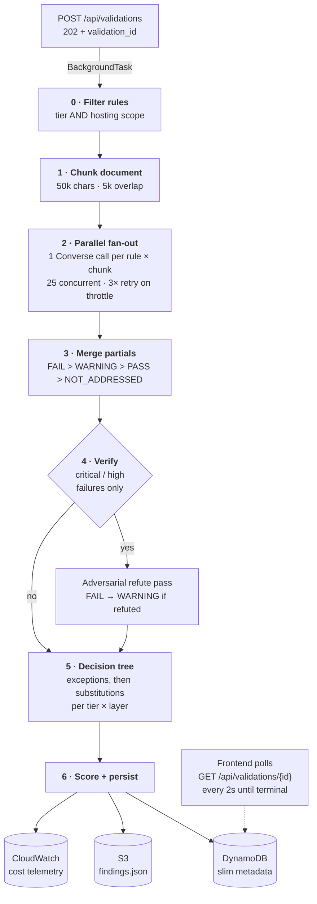
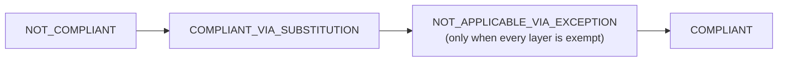

# Validation flow

Validation is a deterministic parallel fan-out rather than an agent. It splits
the document, evaluates each unit of work independently, merges the partial
verdicts by fixed precedence, and applies a decision tree to produce the result.
The same inputs produce the same verdict.

Three paths exist, selected by document shape in
`backend/app/services/parallel_validator.py`:

| Document | Path | Unit of work |
|---|---|---|
| PowerPoint-derived | `validate_pptx_document` | Slide × rule batch (default 10 rules) |
| PDF with embedded images | `pdf_multimodal._validate_pdf_multimodal_async` | Whole document × rule batch (default 8 rules), up to 20 page images per call |
| Text-only PDF | `validate_document` (chunked) | Rule × text chunk |

All three paths complete with the same post-processing: the adversarial
verification pass, the decision tree, the layer and architecture rollup, and the
score. Every path routes through `resolve_decision_tree`, so a design document
containing a diagram receives the same exception and substitution handling as a
text-only one.

## Pipeline

The chunked text path is shown. The image paths differ in stages 1 and 2 only.

Stage detail:

| Stage | Behavior |
|---|---|
| 0 · Filter | A rule applies when `applies_to_tiers` contains the document's service tier and `hosting_scope` matches the document or is `both`. `tier_override` on the request takes precedence over `declared_tier`. Skipped counts are reported per reason. Zero applicable rules produces a null score, not 100. |
| 1 · Chunk | Sections are concatenated with `[Page N]` markers. The sliding window is 50,000 characters with 5,000-character overlap, so a fact spanning a boundary is seen whole by at least one chunk. Documents under 50,000 characters use a single chunk. The hard cap is 1,500,000 characters. Page ranges are recovered from the markers. |
| 2 · Fan-out | Each rule–chunk pair is one Amazon Bedrock Converse call on the Sonnet tier, returning `status`, `evidence`, `recommendation`, `affected_components`, and `source_section` as JSON. The prompt carries the rule description, validation criteria, the verbatim `source_quote` when the extractor captured one, `alternative_criteria`, any scope-matching references, and relationship context for substitution and exception rules. |
| 3 · Merge | One chunk returning `FAIL` makes the rule `FAIL`. A `WARNING` is never masked by a `PASS` from another chunk. Evidence is taken from the lowest-numbered page for stability, and affected components are unioned. If all chunks errored, the result is `WARNING` with the error in the evidence. A `PASS` resting on too few successful chunks is downgraded to `WARNING`. If no chunk addressed the rule, the result is `NOT_ADDRESSED` rather than `FAIL`. |
| 4 · Verify | One additional call per failure, asking the model to refute it using the same evidence. The pass is biased toward confirming: `refuted` defaults to false, and only `refuted` with high or medium confidence downgrades the finding, from `FAIL` to `WARNING` and never to `PASS`. The challenge is recorded on the trace and its tokens count toward run cost. |
| 5 · Decision tree | Rules are grouped by tier and layer. A passing layer-scope exception marks every founding rule in that layer `NOT_APPLICABLE_VIA_EXCEPTION`, and substitutions do not run. Otherwise, per founding rule: a passing rule-scope exception marks it not applicable, a `PASS` stands, and a `FAIL` or `WARNING` attempts its substitutions, where a passing one yields `PASS_VIA_SUBSTITUTION`. The layer verdict is the AND over founding outcomes after substitution. |

Layer verdicts roll up to a single architecture verdict in this precedence:

## Scoring

`_calculate_score` is a severity-weighted percentage — critical 4.0, high 3.0,
medium 2.0, low 1.0, informational 0.5 — with two rules that matter more than
the weights:

- **Excluded from the denominator:** `NOT_ADDRESSED`, which is a coverage gap
  rather than a violation, and both not-applicable states, where the rule was
  waived and counting it would penalize the waiver.
- **Null rather than 100 when there is nothing to score.** A document that
  matched no evaluable rules is not fully compliant, and reporting 100 would
  present it as a clean result.

Credit is assigned at full weight for `PASS` and `PASS_VIA_SUBSTITUTION`, and at
half weight for `WARNING`.

## Auditability

Each finding carries a `trace` built from the contributing chunk: the prompt, the
chunk excerpt the model received, the raw response, input and output token
counts, latency, the resolved model ID, and the reasoning text when extended
thinking was enabled. `NOT_ADDRESSED` findings also carry a trace, because the
run did call Amazon Bedrock for each chunk and received a "not discussed"
response, which a reviewer needs to see.

The per-finding chat endpoints (`POST /api/validations/{id}/findings/{rid}/chat`
and its `/stream` variant) answer questions about a verdict using that trace. The
stored verdict is authoritative: if a reply appears to contradict it, the
response is annotated rather than presented as a re-adjudication. Changing a
verdict requires re-running validation with `force=true`.

## Extended thinking

Each path has its own switch, so enabling extended thinking is not an
all-or-nothing decision (`backend/app/services/pdf_multimodal.py`):

| Path | Environment variable | Default |
|---|---|---|
| Multimodal PDF | `ENABLE_THINKING_MULTIMODAL` | On |
| PowerPoint slides | `ENABLE_THINKING_PPTX` | On |
| Chunked text | `ENABLE_THINKING_CHUNKED` | Off |

The chunked path is off by default because of call volume: it issues one call per
rule and chunk, so a thinking budget applies to every one of them. The image
paths are bounded by page or slide count instead.

Amazon Bedrock constrains the request when thinking is enabled: `temperature`
must be 1.0 and `maxTokens` must exceed `budget_tokens` (default 8000), so each
path reserves capacity for the answer beyond the reasoning.

## Amazon Bedrock client configuration

`_make_bedrock_client` sets `read_timeout` to 300 seconds
(`BEDROCK_READ_TIMEOUT`). The 60-second default terminated multimodal calls that
use extended thinking, which regularly take 60 to 180 seconds because the model
produces the reasoning tokens before the answer block. Botocore retries are set
to one attempt because the validator implements its own throttling backoff, and
`max_pool_connections` is twice the concurrency ceiling.

## Cancellation

`POST /api/validations/{id}/cancel` records the request on the validation row in
DynamoDB. The validator checks for it between rule completions and after the
loop, cancels the in-flight tasks, and unwinds so that the caller persists
`CANCELLED`. Checking between rules rather than mid-call means a cancellation
takes effect within approximately one rule's latency.

The signal is persisted rather than held in process memory because the API scales
to several tasks, and a cancel request frequently reaches a task other than the
one running the job. A 3-second read cache keeps the per-rule checkpoint
inexpensive. If the write fails, the endpoint returns HTTP 502 rather than
reporting a cancellation that did not take effect.

Cancellation is restricted to the user who started the run, or an administrator.
See [RBAC.md](./RBAC.md#resource-ownership-per-row-authorization).

## Service tier filtering and overrides

Rules are filtered before the fan-out by the document's `declared_tier`, or by
`tier_override` on the request when supplied. A rule with no `applies_to_tiers`
is universal and always runs. Malformed tier data is treated permissively, and
the rule is included rather than dropped. Skipped counts are reported as
`skipped_count` with a per-reason breakdown, so a reviewer can determine why a
run evaluated fewer rules than the library contains.

## Caching

Results are cached on `(document_content_hash, standards_set_hash)` per document.
The standards hash covers a selected subset and any inline transient rules, and
is versioned by `validator_version`. A matching prior run short-circuits, and its
`validation_id` is returned with `cached: true` and HTTP 200 instead of 202. A
pending match also short-circuits, so a duplicate request arriving mid-run joins
the in-flight validation rather than starting a second one. `force=true` bypasses
the lookup.

The standards hash covers every rule field that changes a verdict, including
`applies_to_tiers` and `hosting_scope`, because both determine which rules run.
Editing any of them invalidates prior results.

## Cost controls

- **Page cap** — `POST /api/validations` rejects a document above
  `VALIDATION_MAX_PAGES` (default 250). The chunked validator can process
  arbitrary length, but cost grows linearly with chunk count, so a 1,000-page
  upload is rejected at the API boundary.
- **Rule batching on the image paths** — The whole-document multimodal path
  sends 8 rules per call and the PowerPoint path sends 10, so a 30-slide deck
  against 100 rules is 300 calls rather than 3,000.
- **Image ceiling** — Amazon Bedrock Converse accepts at most 20 images per
  call. Pages beyond that are sent as text only, with diagram-bearing pages
  given priority for the image slots.
- **Title slides are skipped** on the PowerPoint path, because they cannot fail
  a rule. Their text is carried forward as orientation for the next slide.
- **Per-validation telemetry** — Calls, input and output tokens, and estimated
  cost are stored on the result and emitted to Amazon CloudWatch. The cost figure
  uses `VALIDATION_INPUT_USD_PER_MTOK` and `VALIDATION_OUTPUT_USD_PER_MTOK`,
  which default to the Sonnet list price. If `VALIDATION_MODEL_ID` is repointed
  at a different model, set these variables as well or the reported cost will be
  incorrect.

## Configurable environment variables

| Variable | Default | Effect |
|---|---|---|
| `VALIDATION_MODEL_ID` | Sonnet tier | Chunked text validator |
| `MULTIMODAL_VALIDATION_MODEL_ID` | Sonnet tier | Whole-document image path |
| `PPTX_VALIDATION_MODEL_ID` | Sonnet tier | Per-slide path |
| `VALIDATION_MAX_CONCURRENT` | 25 | Chunked-path concurrency |
| `MULTIMODAL_MAX_CONCURRENT` | 10 | Image-path concurrency; each call carries images, so the same count consumes considerably more tokens |
| `VALIDATION_MAX_CHUNK_CHARS` | 50000 | Chunk size |
| `VALIDATION_CHUNK_OVERLAP_CHARS` | 5000 | Sliding-window overlap |
| `VALIDATION_MAX_DOC_CHARS` | 1500000 | Validator-side hard cap |
| `VALIDATION_MAX_PAGES` | 250 | API-boundary page cap |
| `RULES_PER_DOC_BATCH` | 8 | Rules per whole-document multimodal call |
| `RULES_PER_SLIDE_BATCH` | 10 | Rules per slide call |
| `VALIDATION_VERIFY_FAILS` | 1 | Adversarial verification pass |
| `VALIDATION_VERIFY_SEVERITIES` | critical,high | Which failures are verified |
| `VALIDATION_VERIFY_MAX_TOKENS` | 400 | Verification call budget |
| `BEDROCK_READ_TIMEOUT` | 300 | Converse read timeout, in seconds |
